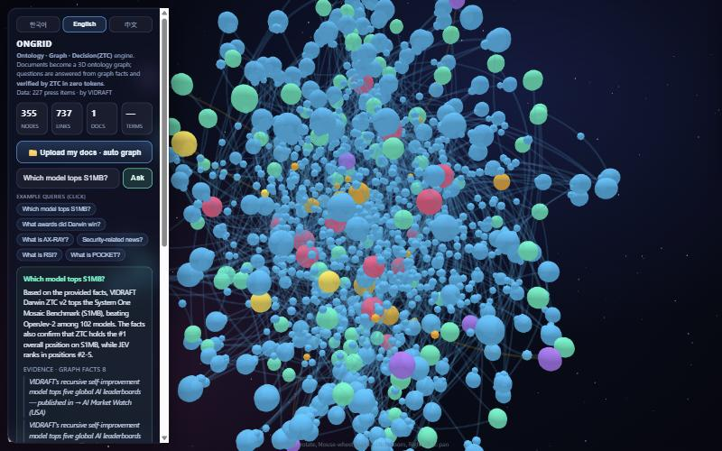
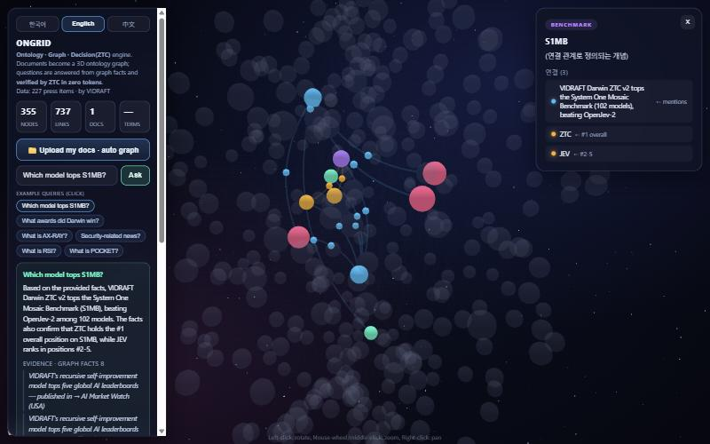

<div align="center">

# 🌌 ONGRID

### **O**ntology-**N**ative **G**raph · **R**etrieval · **I**nference · **D**ecision

**A living knowledge grid that structures your documents, retrieves facts, reasons an answer — and verifies whether that answer is true, in zero tokens.**

문서를 3D <abbr title="An ontology graph structures knowledge as typed entities and typed relations.">온톨로지 그래프</abbr>로 구성하고, 질문하면 그래프 사실을 근거로 LLM이 답하며, 그 답을 <abbr title="Zero-Token Confidence / ZTC-Judge: verifies an answer in one forward pass, generating zero tokens.">ZTC</abbr>가 **0토큰으로 판정**합니다.

[](https://huggingface.co/spaces/FINAL-Bench/ONGRID)
[](https://vidraft.net)
[](LICENSE)

[](https://huggingface.co/FINAL-Bench/ZTC-Judge-9B)
[](https://huggingface.co/spaces/hotchpotch/S1MB-leaderboard)
[](https://www.python.org/)
[](https://fastapi.tiangolo.com/)
[](https://threejs.org/)
[](#-contributing)
[](#-features)

<p align="center">
  
</p>

</div>

---

> **ONGRID in one line:** an open **ontology graph + <abbr title="Graph-based Retrieval-Augmented Generation.">GraphRAG</abbr>** engine that renders knowledge as a glowing **3D universe**, answers from graph facts, and **verifies every answer with a zero-token judge (ZTC)**.

Most GraphRAG tools **retrieve** and **generate**. ONGRID adds the missing step the whole industry is scared of: **decision** — telling you whether the answer is actually true.

## 🧠 The ONGRID pipeline

| | Stage | What happens | Tech |
|---|---|---|---|
| **O·N·G** | Ontology-Native Graph | Documents → typed entities + relations → one 3D graph | three.js · 3d-force-graph |
| **R** | Retrieval | Pull the facts relevant to your question | GraphRAG |
| **I** | Inference | An LLM answers **only from those facts** | LLM API |
| **D** | **Decision** | **ZTC-Judge scores if the answer is trustworthy — 0 generated tokens** | FINAL-Bench ZTC-Judge |

<div align="center">

**🪐 Structure → 🔎 Retrieve → 🧠 Reason → 🛡️ Decide**

*Roadmap: a self-evolving grid — it grows and refines itself as you feed it (RSI).*

</div>

## 🚀 Live demo

👉 **[Open ONGRID on Hugging Face](https://huggingface.co/spaces/FINAL-Bench/ONGRID)**

The default universe is built from **227 real press articles** (models, benchmarks, media, topics). Click an example query and watch the graph focus, the grounded answer, and the **ZTC verdict badge** appear.

## 📸 Screenshots

| Ask & get a grounded answer, verified by ZTC | The whole knowledge universe |
|---|---|
|  |  |

*Ask "Which model tops S1MB?" → the graph focuses, the LLM answers only from retrieved facts, and the answer is verified in zero tokens.*

## 🧩 Features

- 🌐 **Trilingual** — 한국어 · English · 中文, auto-detected, one-click switch.
- 🪐 **3D ontology graph** — typed nodes, curved glowing edges, clustering, search, click-to-focus.
- 🧠 **Grounded answers** — the LLM answers *only* from retrieved graph facts, with evidence shown.
- 🛡️ **Zero-token verification** — every answer judged by [ZTC-Judge](https://huggingface.co/FINAL-Bench/ZTC-Judge-9B) in one forward pass.
- 📁 **Bring your own docs** — upload `.md / .txt / .json / .csv`; parsed in your browser, nothing uploaded.
- 🧱 **Open & on-prem** — Apache-2.0, runs anywhere Docker runs.

## ⚡ Run it

```bash
git clone https://github.com/openaiteams/ongrid.git
cd ongrid
export ANTHROPIC_API_KEY=sk-ant-...   # never commit keys
docker build -t ongrid . && docker run -p 7860:7860 -e ANTHROPIC_API_KEY=$ANTHROPIC_API_KEY ongrid
# open http://localhost:7860
```

| Env var | Default | Meaning |
|---|---|---|
| `ANTHROPIC_API_KEY` | — | LLM key for grounded answers |
| `ZTC_REPO` | `FINAL-Bench/ZTC-Judge-4B` | ZTC-Judge model (`-9B`/`-27B` on GPU) |
| `KNOU_MODEL` | `claude-haiku-4-5-20251001` | answer model id |

## ❓ FAQ

<details><summary><b>What is an ontology graph?</b></summary>
Knowledge represented as typed entities and typed relations — concepts and exactly how they connect. ONGRID builds one automatically from documents and renders it in 3D.
</details>
<details><summary><b>What is zero-token verification (ZTC)?</b></summary>
ZTC judges whether an answer is trustworthy in a single forward pass, generating no tokens. ONGRID grades every answer so you see a trust verdict, not just text.
</details>
<details><summary><b>How is ONGRID different from other GraphRAG tools?</b></summary>
It adds a <b>decision</b> layer: after retrieve-and-answer, ZTC-Judge verifies the answer. It is also fully 3D, trilingual, and runs your docs in the browser.
</details>

## 🔗 Links

- 🤗 Live demo: https://huggingface.co/spaces/FINAL-Bench/ONGRID
- 🛡️ ZTC-Judge: https://huggingface.co/FINAL-Bench/ZTC-Judge-9B
- 🏆 S1MB leaderboard (ZTC #1 of 102): https://huggingface.co/spaces/hotchpotch/S1MB-leaderboard
- 🌐 VIDRAFT: https://vidraft.net

## 📫 Connect

- 🌐 Website — https://vidraft.net
- 🤗 Hugging Face — [FINAL-Bench](https://huggingface.co/FINAL-Bench) · [VIDraft](https://huggingface.co/VIDraft)
- 🧵 Threads — [@vidraft_lab](https://www.threads.com/@vidraft_lab)
- 𝕏 X — [@VIDRAFT_ai](https://x.com/VIDRAFT_ai)
- ✉️ Email — `vidraft@mail.vidraft.net`

## 🤝 Contributing

Issues and PRs welcome — new extractors, languages, visual themes, ZTC integrations.

## 📜 License

Apache-2.0 · Built by **[VIDRAFT](https://vidraft.net)** · *Beyond AI, Toward AGI.*

<div align="center">
<sub>ontology graph · knowledge graph · GraphRAG · zero-token verification · ZTC · LLM answer verification · hallucination detection · 3D knowledge visualization · 지식그래프 · 온톨로지 · 本体图谱</sub>
</div>
